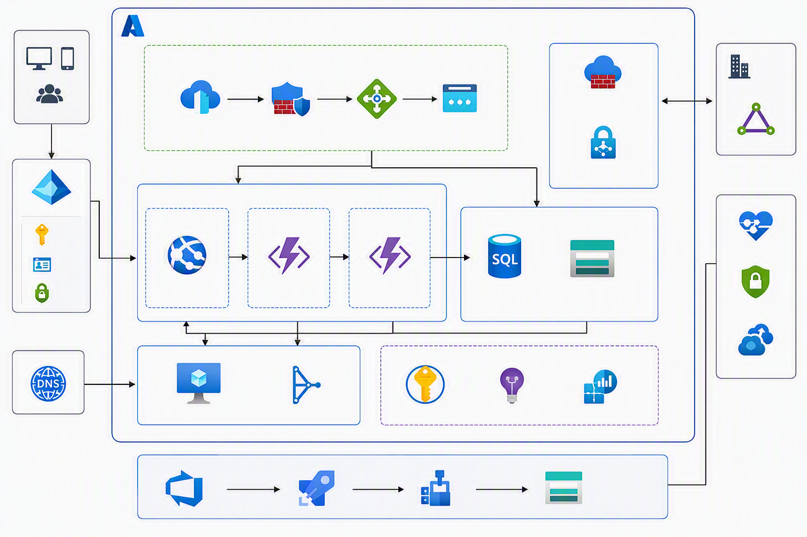

# Grok 4.6 C# Demo on Microsoft Foundry


[](https://github.com/taswar/Grok46MSFoundryDemo/actions/workflows/dotnet.yml)

[](LICENSE)
[](CONTRIBUTING.md)

- 📖 Full walkthrough: [Grok 4.6 in Microsoft Foundry for C# Developers](https://taswar.zeytinsoft.com/grok-4-6-csharp-developers-guide/?utm_source=github&utm_medium=readme&utm_campaign=Grok46MSFoundryDemo&utm_content=walkthrough)
- ⭐ If this sample helps you, star the repo so other .NET developers can find it.
- 🔁 Related: [Grok 4.7 C# Demo](https://github.com/taswar/Grok-4.7-Demo-CSharp), the next Grok version on Foundry
- For more C# samples using other AI models, see [AI models for C# developers](https://taswar.zeytinsoft.com/foundry-ai-models-csharp/?utm_source=github&utm_medium=readme&utm_campaign=Grok46MSFoundryDemo&utm_content=ai-models-hub)
- For my free ebook on prompt engineering, see [Prompt Engineering for .NET Developers](https://github.com/taswar/PromptEngineeringForDotNetDevelopers)

A .NET 10 console app demonstrating how to call **Grok 4.6** (an xAI partner/MaaS model) hosted on **Microsoft Foundry** through `Microsoft.Extensions.AI`, using Entra ID (passwordless) authentication.

Grok is not a native Azure OpenAI deployment, so the app talks to it via the generic `OpenAI.Chat.ChatClient` pointed at the Foundry model endpoint (with a `BearerTokenPolicy` and an `api-version` pipeline policy), then wraps it with `IChatClient` for tool calling, structured output, and multi-modal input.

## What it demonstrates

1. **Tool calling** — a deployment-safety agent that checks service health and error rate before recommending a deploy.
2. **Multi-file code review** — reviewing an interface, implementation, and caller together to catch cross-file issues.
3. **Structured, decision-ready output** — forcing a JSON response (`ChatResponseFormat.ForJsonSchema<VendorRecommendation>()`) to compare vendors.
4. **Multi-modal input** — reviewing an architecture diagram image for single points of failure (requires an `architecture-diagram-spof.png` file in the working directory).

The diagram Grok reviews in case 4 is included in the repo:



## Quick start

```powershell
git clone https://github.com/taswar/Grok46MSFoundryDemo.git
cd Grok46MSFoundryDemo
dotnet user-secrets set "AZURE_AI_ENDPOINT" "https://<your-resource>.services.ai.azure.com/models"
az login
dotnet run
```

## Prerequisites

- [.NET 10 SDK](https://dotnet.microsoft.com/download)
- [Azure CLI](https://learn.microsoft.com/cli/azure/install-azure-cli)
- A Microsoft Foundry resource with a Grok 4.6 deployment
- The **Cognitive Services User** (or **Azure AI Developer**) role assigned to your identity on the Foundry resource

## Required libraries

Already referenced in `Grok46MSFoundryDemo.csproj`:

| Package | Version |
| --- | --- |
| `Azure.AI.OpenAI` | `2.1.0` |
| `Azure.Identity` | `1.21.0` |
| `Microsoft.Extensions.AI` | `10.9.0` |
| `Microsoft.Extensions.AI.OpenAI` | `10.9.0` |
| `Microsoft.Extensions.Configuration.EnvironmentVariables` | `10.0.11` |
| `Microsoft.Extensions.Configuration.UserSecrets` | `10.0.11` |

To add them to a fresh project:

```powershell
dotnet add package Azure.AI.OpenAI --version 2.1.0
dotnet add package Azure.Identity --version 1.21.0
dotnet add package Microsoft.Extensions.AI --version 10.9.0
dotnet add package Microsoft.Extensions.AI.OpenAI --version 10.9.0
dotnet add package Microsoft.Extensions.Configuration.EnvironmentVariables --version 10.0.11
dotnet add package Microsoft.Extensions.Configuration.UserSecrets --version 10.0.11
```

To restore packages for this project:

```powershell
dotnet restore
```

## Configuration

Configuration is read via `ConfigurationBuilder` (user secrets, then environment variables).

| Setting | Required | Description |
| --- | --- | --- |
| `AZURE_AI_ENDPOINT` | Yes | The Foundry models endpoint, e.g. `https://<your-resource>.services.ai.azure.com/models` |
| `AZURE_OPENAI_DEPLOYMENT` | No | Model deployment name. Defaults to `grok-4.6`. |

Set them with `dotnet user-secrets` (recommended for local dev):

```powershell
dotnet user-secrets set "AZURE_AI_ENDPOINT" "https://<your-resource>.services.ai.azure.com/models"
dotnet user-secrets set "AZURE_OPENAI_DEPLOYMENT" "grok-4.6"
```

or via environment variables for the current terminal session:

```powershell
$env:AZURE_AI_ENDPOINT = "https://<your-resource>.services.ai.azure.com/models"
$env:AZURE_OPENAI_DEPLOYMENT = "grok-4.6"
```

## How to run

1. Sign in with the Azure CLI (used by `DefaultAzureCredential`):

   ```powershell
   az login
   ```

2. Configure the endpoint (see above).

3. Run the app:

   ```powershell
   dotnet run
   ```

The app pauses between cases (press Enter to advance) so you can review each scenario's output before moving to the next.

## Why not `AzureOpenAIClient`?

Grok is a partner (MaaS) model, not a native Azure OpenAI deployment, so it can't be reached through `AzureOpenAIClient`'s `/openai/deployments/...` path. This sample uses the generic `OpenAI.Chat.ChatClient` against the Foundry model endpoint instead, with a `BearerTokenPolicy` for Entra ID auth and a custom `api-version` query policy.

## Troubleshooting

| Error | Cause | Fix |
| --- | --- | --- |
| `AZURE_AI_ENDPOINT is not set` | Endpoint not configured | Set it via `dotnet user-secrets set` or the environment variable |
| `HTTP 404 (404) Resource not found` | Endpoint has the wrong path (e.g. `/openai/v1/`) or wrong deployment name | Use the `/models` path and confirm the deployment name matches Foundry |
| `ManagedIdentityCredential ... IMDS ... 169.254.169.254` | Running locally without sign-in | Run `az login` |
| `401 Unauthorized` | Missing role assignment on the Foundry resource | Ensure your identity has the **Cognitive Services User** role |

## License

This project is licensed under the MIT License. See [LICENSE](LICENSE).
